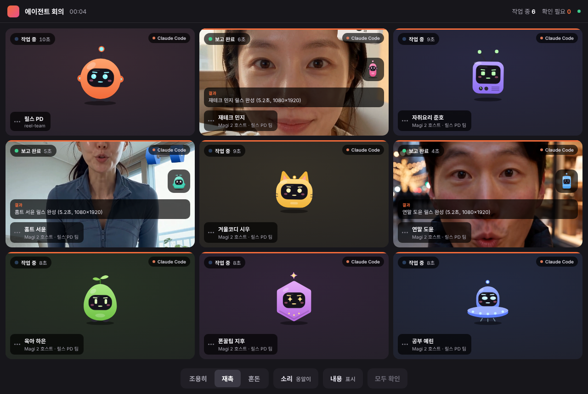

# agent-monitor

옆 화면(아이패드, 모니터 한쪽)에 켜 두고 AI 에이전트에게 일을 시키면,
누가 일하는 중이고 누가 끝났는지, 그리고 **만들어 낸 이미지·영상(Higgsfield 등)** 을 바로 보여주는 모니터입니다.

Claude Code, Codex, Gemini CLI의 세션과 서브에이전트가 화상회의 화면의 로봇 참가자로 들어옵니다.
끝났는데 안 봐주면 재촉하고, 계속 방치하면 다 같이 떠듭니다. 확인하면 조용해집니다.



- **설치할 패키지 없음.** Python 3.9 이상 표준 라이브러리와 HTML 파일 하나.
- **결과물을 바로 보여줌.** 생성된 이미지·영상의 주소나 파일 경로가 나오면 그 에이전트 타일에서 재생합니다. 버튼 하나로 내려받거나 Finder에서 엽니다.
- **서브에이전트까지.** 세션이 띄운 서브에이전트가 각자 타일로 들어오고, 각자의 결과를 띄웁니다.
- **목소리.** 원하면 오픈소스 음성 모델(Supertonic 3)로 로봇마다 다른 목소리를 냅니다.
- **조심스럽게.** 응답 전문은 보내지 않고 짧은 미리보기만 씁니다. 기본은 이 컴퓨터에서만 접속됩니다.

## 빠른 시작

```bash
git clone <이 저장소> && cd agent-monitor
python3 start.py --open
```

이 한 줄이 설치된 CLI(Claude Code, Codex, Gemini CLI)에 훅을 연결하고, 모니터 서버(`http://localhost:8790`)를 켜고, 브라우저로 화면을 엽니다.
그다음 평소처럼 CLI 세션을 시작해 일을 시키면 됩니다.

- 훅은 **처음 한 번만** 등록합니다. 기존 설정은 그대로 두고 agent-monitor 항목만 더하며, 같은 폴더에 `.bak-agent-monitor-<시각>` 백업을 남깁니다.
- 모니터가 꺼져 있어도 CLI는 평소처럼 동작합니다.
- 훅 없이 화면만 먼저 보려면 `http://localhost:8790/?demo=1`.

등록 뒤 CLI마다 한 번 할 일:

| CLI | 할 일 |
|---|---|
| Claude Code | 그 전부터 열려 있던 세션은 다시 시작 |
| Codex | 실행 후 `/hooks` 에서 새 훅을 검토하고 신뢰 |
| Gemini CLI | 다시 시작 (`/hooks panel` 에서 확인) |

자주 쓰는 옵션:

```bash
python3 start.py --lan                      # 아이패드 등 같은 와이파이의 기기에서 보기
python3 start.py --install-voice            # AI 음성 설치하고 켜기
python3 start.py --results-dir ~/Movies/ai  # 저장·폴더 버튼으로 모을 폴더
python3 start.py --port 9000                # 다른 포트 (훅 주소도 같이 바뀜)
python3 start.py --no-preview               # 응답 미리보기·명령·결과물을 보내지도 보여주지도 않기
python3 start.py --no-hooks                 # CLI 설정은 건드리지 않고 서버만
```

## 아이패드에 띄우기

```bash
python3 start.py --lan
```

터미널에 나오는 `http://192.168.x.x:8790/?token=...` 주소를 같은 와이파이의 기기에서 엽니다.
주소 끝에 `&hint=0` 을 붙이면 "탭하면 소리가 켜져요" 안내가 뜨지 않습니다. 소리는 화면을 한 번 탭한 뒤부터 납니다.
토큰이 없는 다른 기기의 요청은 거절됩니다. 공용 와이파이에서는 쓰지 마세요.

## 생성 결과 보기 (Higgsfield 등)

에이전트가 이미지·영상을 만들면, 결과가 나오는 순간 그 타일이 "결과물 나왔어요" 하고 결과를 띄웁니다.

| 어디서 시키나 | 할 일 |
|---|---|
| Claude Code · Codex · Gemini CLI | 모니터만 켜 두면 됩니다. 도구 결과나 마지막 응답에 나온 결과 주소·파일 경로를 훅이 잡습니다. (예: Claude Code에 Higgsfield MCP를 연결해서 생성) |
| Claude 데스크톱 앱 | [MCP](#훅이-없는-곳-mcp) 를 연결합니다. Claude가 생성이 끝나면 `monitor_report` 로 결과를 올립니다 |
| 직접 만든 스크립트 | 결과 파일 경로나 주소를 출력하면 됩니다. [이름표·결과 한 줄](#타일-이름표결과-한-줄) 도 붙일 수 있습니다 |

결과물로 잡는 것:

- `https://…/파일.mp4` 같은 인터넷 주소
- 이 컴퓨터에 **실제로 있는** 파일 경로: `/절대/경로`, `~/경로`, `./상대`, `폴더/파일.png`
- 확장자: mp4 mov webm m4v png jpg webp gif

결과물이 뜬 타일 아래쪽 이름표 옆의 버튼:

| 버튼 | 동작 |
|---|---|
| 내려받기 | 그 결과물을 파일로 받기. 아이패드에서도 됩니다 |
| 폴더 | 이 컴퓨터의 Finder(파일 탐색기)에서 그 파일을 선택한 채로 열기. 서버가 도는 컴퓨터의 화면에서만 보입니다 |
| × | 타일을 화면에서 내리기. 그 세션이 다시 움직이면 돌아옵니다 |

인터넷 주소인 결과물은 내려받기·폴더를 누르는 순간 결과물 폴더(기본 `~/Downloads/agent-monitor`)에 저장합니다. 이름이 같은 다른 결과물은 덮어쓰지 않고 `-2` 를 붙입니다.

영상 타일은 눌러서 소리를 켜고 끕니다. 결과물이 절반 넘게 떠 있으면 세로 영상이 잘 보이도록 타일을 세로로 길게 배치합니다.

## 화면 읽는 법

| 표시 | 뜻 | 재촉 대상 |
|---|---|---|
| 작업 중 | 턴이 진행 중 | |
| 백그라운드 작업 중 | 응답은 끝났지만 백그라운드 작업이 남음 (Claude Code) | |
| **끝남** | 턴이 끝나 내 입력을 기다림 | ✓ |
| **질문 있음** | 마지막 응답이 질문으로 끝남 | ✓ |
| **승인 필요** | 권한 승인이나 입력을 기다리며 멈춤. 실행하려는 명령이 같이 뜸 | ✓ |
| **오류** | API 오류로 턴이 끊김 | ✓ |
| 보고 완료 | 서브에이전트가 결과를 넘김 | |
| 대기 | 세션은 열려 있고 할 일 없음 | |

- "끝남"은 작업 완료가 아니라 **턴 종료**입니다. "질문 있음"은 마지막 응답이 물음표로 끝나는지로 추정합니다.
- 끝나면 먼저 한마디 하고(약 1.5초) 그다음 타일에 결과 한 줄, 질문, 기다리는 명령, 결과물이 나타납니다.
- 아래 **내용** 버튼으로 이 표시를 한 번에 숨길 수 있습니다. 화면을 촬영·공유할 때 쓰세요.

### 타일이 생기고 사라지는 때

| 타일 | 생김 | 사라짐 |
|---|---|---|
| 세션 | CLI 세션을 시작할 때 | 세션을 끌 때 |
| 서브에이전트 | 세션이 서브에이전트를 띄울 때. 위쪽에 부모 세션의 색 띠, 이름 아래 `역할 · 부모 이름 팀` | 보고 후 20초. 결과물이 있으면 부모 세션에 다음 명령을 넣을 때까지 (방금 보고했으면 2분은 남김) |
| 직접 올린 타일 | MCP나 API로 올릴 때 | 지울 때 |

어느 타일이든 × 로 바로 내릴 수 있습니다. 8시간 넘게 소식이 없는 타일은 저절로 정리됩니다.
Claude Code가 "서브에이전트가 끝났다"고 세션에 스스로 넣는 알림은 사람의 새 명령으로 치지 않습니다.

### 확인하는 방법

- 그 타일을 누른다.
- 아래 **모두 확인** 버튼, 또는 키보드 `A` / `Space`.
- 그 세션에 다음 명령을 입력한다. (자동으로 풀립니다)

### 모드

| 모드 | 동작 |
|---|---|
| 조용히 | 말풍선만 한 번. 소리 없음 |
| 재촉 (기본) | 끝난 즉시 한 번 말하고, 1분마다 수위를 올려 다시 말함. 한 명씩 차례로 |
| 혼돈 | 확인 안 된 에이전트가 전부 동시에 계속 떠듦. 확인하면 그 타일만 멈춤 |

키보드 `1` `2` `3` 으로도 바꿉니다. 모드는 서버에 저장되어 열려 있는 모든 화면에 같이 적용됩니다.

### 소리

하단 **소리** 버튼으로 바꿉니다.

| 소리 | 설명 |
|---|---|
| AI 음성 | 서버가 오픈소스 모델로 대사를 실제 목소리로 만듦. 로봇마다 다른 목소리, 입 모양이 소리에 맞고, 혼돈 모드에서 겹쳐 말함 |
| 옹알이 | 설치 없이 브라우저에서 합성하는 짧은 소리 |
| 브라우저 음성 | 운영체제에 깔린 음성으로 읽기. 한 번에 한 문장 |
| 끔 | |

### 주소 옵션

| 옵션 | 예 | 뜻 |
|---|---|---|
| `every` | `?every=30` | 재촉 간격(초). 기본 60 |
| `chaos_after` | `?chaos_after=5` | 5분 넘게 방치된 에이전트가 있으면 자동으로 혼돈. 기본 꺼짐 |
| `voice` | `?voice=babble` | `ai` · `babble` · `tts` · `off`. 기본은 AI 음성이 있으면 `ai`, 없으면 `babble` |
| `tts_voice` | `?tts_voice=유나` | 브라우저 음성을 이름으로 고정 |
| `lang` | `?lang=en` | `ko` · `en`. 기본은 브라우저 언어 |
| `content` | `?content=0` | 결과·질문·명령·결과물 표시 숨김 |
| `hint` | `?hint=0` | "탭하면 소리가 켜져요" 안내 숨김 |
| `demo` | `?demo=1&speed=2` | 훅 없이 흐름만 재생 |

## AI 음성

[Supertonic 3](https://github.com/supertone-inc/supertonic) (Supertone, 코드 MIT · 모델 OpenRAIL-M)을 씁니다. 한국어를 포함한 31개 언어, 기본 음성 10개(M1–M5, F1–F5)가 있고 CPU에서 이 컴퓨터 안에서만 돕니다.

```bash
python3 start.py --install-voice
```

- `pip install supertonic` 을 대신 실행하고, 서버가 처음 켜질 때 모델(약 400MB)을 Hugging Face에서 한 번 내려받습니다. 서버 터미널에 `AI 음성: 준비됨` 이 뜨면 끝입니다.
- 내려받는 동안과 실패했을 때는 옹알이로 대신합니다. 끄려면 `--no-voice`.
- 아이패드 등 다른 기기에서도 소리는 이 컴퓨터가 만들어 보내므로 같은 목소리가 납니다.
- 모델은 이 저장소에 들어 있지 않고 다시 배포하지도 않습니다. 각자 자기 컴퓨터의 `~/.cache/supertonic3` 에 받습니다.
- Supertone이 이 오픈소스 프로젝트의 개발을 멈춘다고 알린 상태라, 모델 내려받기가 막히면 옹알이로 대신합니다.

## 타일 이름표·결과 한 줄

에이전트가 실행한 도구(스크립트)가 아래 줄을 출력하면 그 에이전트 타일의 이름·역할·결과 한 줄이 바뀝니다.

```
[agent-monitor] name: 홈트 서윤
[agent-monitor] role: 영상 담당
[agent-monitor] text: 홈트 서윤 릴스 완성 · 5.2초
```

- 서브에이전트가 일을 시작할 때 이 줄을 출력하는 명령을 먼저 실행하면, 작업하는 동안 내내 그 이름으로 보입니다.
- `text` 는 에이전트의 마지막 답에 요약할 문장이 없을 때(예: 경로만 답했을 때)도 결과 한 줄을 보장합니다.

## 훅이 없는 곳: MCP

Claude 데스크톱 앱처럼 훅이 없는 환경에서는 에이전트가 도구 호출로 직접 타일을 올립니다.

```bash
# Claude Code
claude mcp add agent-monitor --scope user -- python3 /경로/agent-monitor/mcp_server.py
```

```json
// Claude 데스크톱 앱: claude_desktop_config.json 의 mcpServers 안에
"agent-monitor": {
  "command": "/usr/bin/python3",
  "args": ["/경로/agent-monitor/mcp_server.py"]
}
```

| 도구 | 용도 |
|---|---|
| `monitor_report` | 타일 만들기·갱신 (`id`, `state`, `name`, `role`, `parent`, `text`, `ask`, `detail`, `media_url`). `media_url` 은 인터넷 주소나 이 컴퓨터의 파일 절대 경로 |
| `monitor_state` | 현재 타일과 확인 여부 읽기 |
| `monitor_remove` · `monitor_reset` | 타일 지우기 · 전부 비우기 |

MCP 서버는 "이미지·영상 생성이 끝나면 결과 주소와 함께 올리라"는 안내를 같이 보내므로, Claude가 따로 시키지 않아도 결과를 올립니다. 설정을 바꾼 뒤에는 앱을 다시 켜야 적용됩니다.

## 다른 도구 연결하기 (API)

훅도 MCP도 없는 도구는 요청 한 줄로 타일을 만들 수 있습니다.

```bash
curl -X POST http://127.0.0.1:8790/api/agent -H 'Content-Type: application/json' \
  -d '{"id":"nightly-build","project":"ci","state":"waiting","text":"빌드 끝났습니다.","media_url":"/Users/me/out/report.png"}'
```

`state`: `idle` `working` `waiting` `blocked` `error` `reported`
그 밖의 필드: `name` `role` `parent` `project` `text` `ask` `detail` `media_url`
파일 경로는 이 컴퓨터에서 보낸 요청만 받습니다. 받지 못한 결과물이 있으면 응답의 `agent.media_ignored` 에 개수가 옵니다.

| API | 용도 |
|---|---|
| `GET /api/state` | 현재 상태 전체 |
| `GET /events` | 실시간 스트림 (SSE) |
| `GET /media/<id>.<확장자>` | 결과물 파일 (부분 요청 지원) |
| `GET /api/download?url=...` | 화면에 떠 있는 결과물을 파일로 받기 |
| `POST /api/reveal` | `{"url": "..."}` 그 결과물을 파일 관리자에서 열기 (이 컴퓨터에서 온 요청만) |
| `POST /hook/{claude,codex,gemini}` | 훅 이벤트 수신 |
| `POST /api/ack` | `{"id": "..."}` 또는 `{"all": true}` |
| `POST /api/mode` | `{"mode": "quiet" \| "nag" \| "chaos"}` |
| `POST /api/remove` · `/api/reset` | 타일 지우기 · 전부 비우기 |

## 보내는 정보와 보안

훅 스크립트(`hooks/agent_hook.py`)가 서버로 보내는 것은 아래가 전부입니다.

항상:

- 이벤트 이름, 세션 ID, 서브에이전트 ID와 타입
- 알림 종류, 승인을 기다리는 도구 이름(`Bash` 등), 오류 종류
- 작업 폴더의 **마지막 이름 하나** (`/Users/me/work/shop` → `shop`)
- 도구가 출력한 `[agent-monitor] name:` / `role:` 줄
- 사람이 친 명령인지, CLI가 스스로 넣은 알림인지 (내용은 보내지 않음)

미리보기 (기본 켬, `--no-preview` 로 끔):

- 마지막 응답의 앞부분과 끝부분, 각각 240자까지
- 승인을 기다리는 명령이나 경로 한 줄, 200자까지
- 이미지·영상 결과물 4개까지: 인터넷 주소, 또는 이 컴퓨터에 실제로 있는 파일 경로
- 도구가 출력한 `[agent-monitor] text:` 줄

보내지 않는 것: 프롬프트, 응답 전문, 도구 입력과 출력 전문, 작업 폴더 전체 경로, 트랜스크립트 경로.
서버는 받은 값을 메모리에만 두고 디스크에 쓰지 않습니다. (내려받기·폴더 버튼을 누른 결과물만 결과물 폴더에 저장)

미리보기는 화면에 그대로 뜹니다. `TOKEN=...`, `Authorization: Bearer ...`, `--password ...` 같은 꼴과 32자 이상 이어진 문자열은 `***` 로 가리지만 **완벽하지 않습니다.** 민감한 작업 화면을 촬영·공유할 때는 끄거나 **내용** 버튼으로 숨기세요.

서버 쪽 보호:

- 기본 바인딩은 `127.0.0.1`. `--lan` 일 때만 외부에서 접속되고, 그때는 토큰이 필요합니다.
- `Host` 헤더가 IP·`localhost`·`*.local` 이 아니면 거절합니다. (DNS 리바인딩 방지)
- CORS 헤더를 내지 않고 `Content-Type: application/json` 만 받습니다. 다른 사이트의 스크립트가 상태를 읽거나 바꿀 수 없습니다.
- `web/` 폴더 밖의 파일은 서빙하지 않습니다. 예외는 에이전트가 결과물로 알린 파일 하나하나뿐이고, 이 컴퓨터에서 온 요청이 알린, 실제로 있는 이미지·영상 파일이어야 합니다. 화면에는 경로 대신 임의 id 주소로만 나갑니다.
- 내려받기·폴더 열기는 지금 화면에 떠 있는 결과물만 다룹니다. 폴더 열기는 서버가 도는 컴퓨터에서 온 요청만 받습니다.

## CLI별로 잡히는 이벤트

| | Claude Code | Codex | Gemini CLI |
|---|---|---|---|
| 세션 입장/퇴장 | `SessionStart` `SessionEnd` | `SessionStart` `SessionEnd` | `SessionStart` `SessionEnd` |
| 작업 시작 | `UserPromptSubmit` | `UserPromptSubmit` | `BeforeAgent` |
| 끝남 | `Stop` | `Stop` | `AfterAgent` |
| 승인 필요 | `PermissionRequest` `Notification` | `PermissionRequest` | `Notification` |
| 승인 뒤 재개 · 결과물 | `PostToolUse` | `PostToolUse` | `AfterTool` |
| 오류 | `StopFailure` | | |
| 서브에이전트 | `SubagentStart` `SubagentStop` | `SubagentStart` `SubagentStop` | 공식 이벤트 없음 |

- Claude Code는 사용자가 직접 중단하면 `Stop` 을 보내지 않습니다. 이때 타일은 조금 뒤 "대기"로 바뀝니다.
- Codex 훅은 사용자가 신뢰하기 전에는 실행되지 않습니다.
- Gemini CLI 훅은 동기 실행이라 도구 호출마다 훅 실행 시간(수십 ms)이 더해집니다.
- macOS에서 만들고 확인했습니다. Windows는 확인하지 못했습니다.

훅만 따로 다루려면:

```bash
python3 install.py status
python3 install.py install claude     # 하나만
python3 install.py install --dry-run  # 바꿀 내용만 보기
python3 install.py print codex        # 직접 붙여넣을 설정 출력
python3 install.py uninstall          # 훅 제거
```

## 데모

- **화면만:** `http://localhost:8790/?demo=1` 은 훅 없이 가짜 에이전트로 흐름을 재생합니다.
- **실제 에이전트로:** [examples/reel-team](examples/reel-team/) 은 Claude Code 서브에이전트 8명이 릴스를 하나씩 맡아 결과 영상을 올리는 예제입니다. 그 폴더에서 `claude` 를 켜고 `/reels` 를 입력합니다. 에이전트 없이 같은 장면을 재생하는 `replay.py` 도 있습니다.

## 문제 해결

| 증상 | 확인할 것 |
|---|---|
| 세션이 안 들어옴 | `python3 install.py status` 로 훅이 등록됐는지. 등록 전부터 열려 있던 세션은 다시 시작. Codex는 `/hooks` 에서 신뢰 |
| 소리가 안 남 | 화면을 한 번 탭했는지, 모드가 **조용히** 가 아닌지, 하단 **소리** 표시. AI 음성은 서버 터미널에 `준비됨` 이 떠야 함 |
| 아이패드에서 안 열림 | `--lan` 으로 켰는지, 같은 와이파이인지, 토큰이 든 주소 그대로인지 |
| 결과물이 안 뜸 | 주소·경로가 위 확장자로 끝나는지, 파일이 실제로 있는지. 다른 컴퓨터의 경로는 못 띄움 |
| 서버를 다시 켰더니 타일이 없음 | 상태는 메모리에만 있어서 정상. 세션이 다음 이벤트를 보내면 다시 들어옴 |
| `포트 8790 을(를) 열 수 없습니다` | 이미 켜져 있음. 그 창을 쓰거나 `--port` 로 다른 포트 |

## 파일 구성

```
start.py              훅 연결 + 서버 켜기 (보통은 이것만)
server.py             상태 서버 (HTTP + SSE, 결과물 서빙, AI 음성)
hooks/agent_hook.py   CLI 훅 → 서버로 이벤트 전달
install.py            CLI 설정 파일에 훅 등록·제거
mcp_server.py         훅이 없는 곳(Claude 데스크톱 앱 등)용 MCP 서버
web/index.html        화면 (로봇, 재촉, 소리)
examples/reel-team/   서브에이전트 8명 데모
tests/                단위·통합 테스트
```

## 개발

```bash
python3 -m unittest discover -s tests -v
```

서버의 상태 전이, 접근 제어, 결과물 파일 서빙·내려받기, 훅 스크립트, `install.py` 의 설정 병합, 예제 스크립트를 검사합니다.
훅 매핑은 각 CLI의 공식 훅 문서를 기준으로 만들었고, 테스트는 문서에 나온 형식의 이벤트를 흉내 내어 보냅니다.

- Claude Code: https://code.claude.com/docs/en/hooks
- Codex: https://developers.openai.com/codex/hooks
- Gemini CLI: https://geminicli.com/docs/hooks/

## 라이선스

MIT. AI 음성 모델(Supertonic 3)은 저장소에 들어 있지 않으며 OpenRAIL-M 라이선스를 따릅니다.
